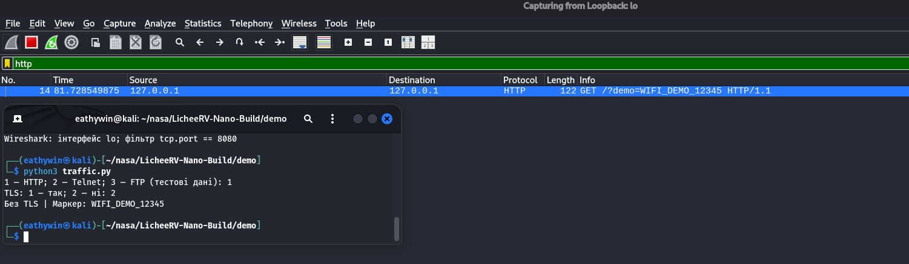
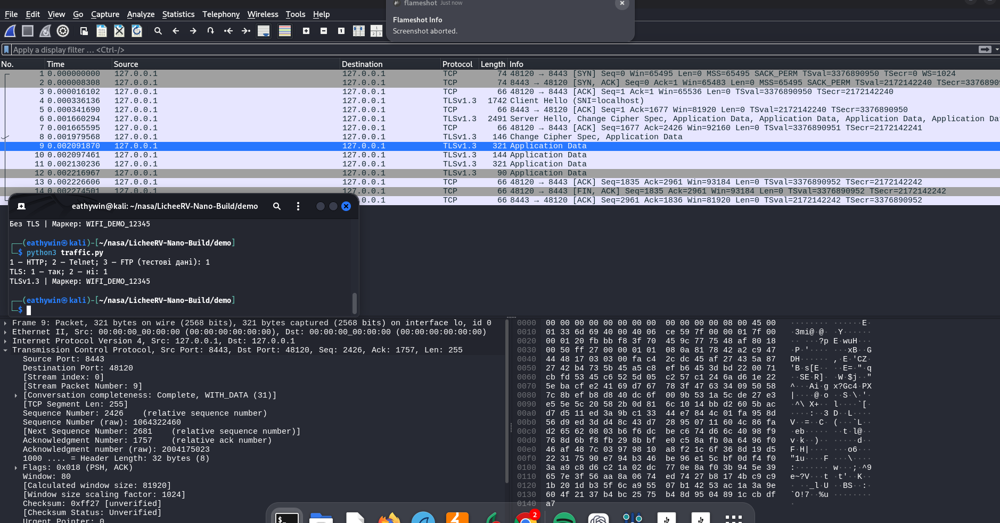
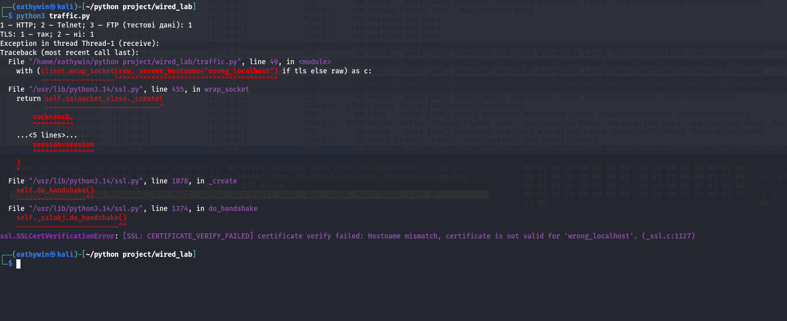
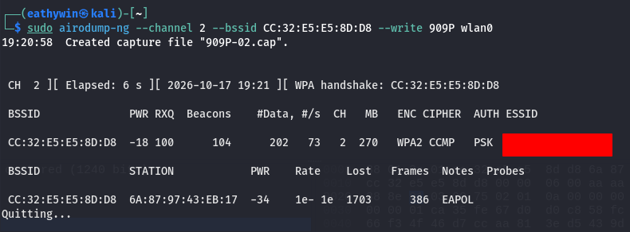

# Лабораторна робота №40
## Захист мережевих і MAVLink-каналів

У цій роботі я дослідив, як захищаються дані під час передавання мережею. Практична частина складається з трьох дослідів: порівняння відкритого TCP-обміну з TLS, аналізу WPA2-рукостискання власної Wi-Fi-мережі та роботи з MAVLink у симуляторі PX4.

Мета роботи - побачити захист на рівні пакетів: які поля можна прочитати, що приховує шифрування та як перевіряється походження повідомлень. Для цього я використав Wireshark, короткі Python-скрипти та власний лабораторний стенд.

## 1. Стенд і порядок роботи

| Частина | Організація досліду |
|---|---|
| TCP/TLS | Python-клієнт і приймач на 127.0.0.1, захоплення на lo |
| Wi-Fi | TP-Link TL-WR850N v2, власний клієнт і USB-адаптер Mercusys у monitor mode |
| MAVLink | PX4 SITL SIH у Docker, QGroundControl і Python-клієнт на одному Kali Linux |
| Аналіз | Wireshark/tshark, Aircrack-ng, Lua-декодер MAVLink |

Я працював на повноцінному Kali Linux. Для локального обміну використав loopback, а для радіозахоплення - окремий USB-адаптер із драйвером rtl8xxxu. Такий поділ дозволив зручно порівняти захист прикладних даних, бездротового каналу та команд керування.

Спочатку я передав навчальний маркер без TLS і з TLS. Потім перевірив сертифікат сервера, захопив EAPOL у власній мережі та розібрав повідомлення MAVLink. Скриншоти й записи трафіку збережено у відповідних папках проєкту.

Робота виконувалася з власною точкою доступу, тестовими даними й локальним симулятором. Команди керування адресувалися PX4 SITL. Дата оформлення звіту: 04.11.2026.

<!-- page -->

## 2. Порівняння відкритого TCP і TLS

Для досліду я використав traffic.py. Скрипт створює локальний приймач, надсилає повідомлення й отримує підтвердження. У числовому меню вибирається тип навчальних даних, потім - використання TLS. Тестовий маркер: WIFI_DEMO_12345.

У http.pcapng збережено 10 пакетів. У кадрі 4 видно HTTP GET із маркером у URL. Через Follow TCP Stream можна прочитати передані дані. Подібний результат дає текстовий TCP-приклад на порту 2323.

Після вибору TLS обмін відбувається на порту 8443. У https.pcapng збережено 15 пакетів: встановлення з'єднання, узгодження TLS 1.3 і записи Application Data. Тестовий маркер у цьому записі відкритим текстом не читається.

Отже, в одному й тому самому інструменті добре видно різницю: відкритий TCP дозволяє прочитати вміст, а TLS захищає прикладні дані. Адреси, порти, довжини пакетів і час передавання залишаються доступними для мережевого аналізу.

<!-- page -->

## 3. Перевірка сертифіката сервера

Шифрування доповнюється перевіркою адресата. Клієнт використовує PROTOCOL_TLS_CLIENT, довіряє тимчасовому сертифікату лабораторного приймача та перевіряє ім'я localhost. Сертифікат містить SAN для localhost і 127.0.0.1 [1].

У sertificate_test.pcapng є 24 кадри. Я порівняв два варіанти імені: localhost і wrong_localhost. У другому випадку клієнт надіслав fatal Bad Certificate, після чого з'єднання завершилося.

| Кадр | Подія у Wireshark |
|---|---|
| 4 | ClientHello із SNI localhost |
| 6-12 | TLS-обмін першого з'єднання |
| 19 | ClientHello із SNI wrong_localhost |
| 23 | Fatal alert: Bad Certificate |
| 24 | TCP RST після завершення з'єднання |

Скриншот термінала ілюструє перевірку hostname. Разом із записом трафіку він пояснює поведінку клієнта: з правильним ім'ям установлюється TLS-з'єднання, а неправильне ім'я спричиняє помилку перевірки.

У цьому досліді також видно SNI у ClientHello. Отже, шифрування прикладних даних і видимість метаданих варто аналізувати окремо. Для перегляду я використав фільтр tls.handshake.extensions_server_name або tls.alert_message.

<!-- page -->

## 4. WPA2-рукостискання власної мережі

Wi-Fi-частину я виконав із власним роутером TP-Link і USB-адаптером Mercusys. Адаптер працював у monitor mode та приймав кадри 802.11. Для стабільного захоплення важливо визначити поточний канал точки доступу й зафіксувати на ньому сканер.

У airodump-ng номер угорі показує канал адаптера, а CH у рядку точки - канал AP. Після початку захоплення підключення власного клієнта створює обмін EAPOL. У Wireshark його зручно виділити фільтром eapol.

У handshake.pcap збережено чотири EAPOL Key повідомлення 1-4. Від першого до останнього минуло приблизно 0,014 с. Цей обмін підтверджує володіння ключовим матеріалом і встановлює ключі для захищеної сесії.

| Етап | Призначення |
|---|---|
| M1 | Точка доступу передає ANonce |
| M2 | Клієнт передає SNonce та MIC |
| M3 | Точка підтверджує обмін і передає захищені ключові дані |
| M4 | Клієнт підтверджує завершення рукостискання |

Окремо я провів контрольну словникову перевірку: навчальний пароль містився у словнику, а Aircrack-ng показав KEY FOUND. Програма перевіряє відповідність кандидата захопленому обміну за MIC. Сам пароль у EAPOL відкрито не передається.

Практичний висновок: для WPA2-Personal важлива довга унікальна парольна фраза, оскільки захоплений обмін дозволяє перевіряти кандидати офлайн. Після завершення досліду адаптер повертається в managed mode для звичайного доступу до мережі.

<!-- page -->

## 5. Режими захисту Wi-Fi та відомі атаки

Практичний стенд працював із WPA2-Personal. Для оцінки варіантів захисту я порівняв його з WPA2-Enterprise і WPA3-Personal [2-4].

| Режим | Основна особливість | Застосування |
|---|---|---|
| WPA2-Personal | Спільна парольна фраза, просте налаштування | Домашні та невеликі мережі; потрібен сильний пароль |
| WPA2-Enterprise | 802.1X/EAP, зазвичай RADIUS, окремий доступ | Організації з обліком користувачів і відкликанням доступу |
| WPA3-Personal | SAE, захист від звичайного пасивного офлайн-підбору, PMF | Сумісні точки й клієнти; WPA3-only за можливості |

Enterprise зручний тим, що доступ можна видати або відкликати для окремої людини. Наприклад, при звільненні працівника достатньо вимкнути його обліковий запис або сертифікат. За спільного PSK зміна доступу зазвичай потребує заміни пароля на всіх пристроях. Властивості Enterprise також залежать від EAP-методу й перевірки сертифіката сервера.

**KRACK.** Уразлива реалізація могла повторно встановити вже використаний ключ після повторного повідомлення M3. Разом із цим скидалися пов'язані лічильники. Якщо новий пакет повторює попередню пару ключ/nonce, порушуються вимоги безпечного шифрування. Наслідки залежать від реалізації та шифру: можливі розкриття частини даних і повтор трафіку [3].

Приклад: клієнт уже надіслав пакети з номерами 1, 2, 3. Після повторного встановлення того самого ключа лічильник знову починається з 1. Захист полягає в оновленні клієнта й AP: повтор M3 має оброблятися без скидання стану встановленого ключа. KRACK стосується обробки ключів, а пароль Wi-Fi залишається окремим секретом.

**Dragonblood.** Дослідження охопило слабкості ранніх реалізацій SAE/Dragonfly та EAP-pwd: побічні канали часу/кешу, downgrade і виснаження ресурсів. Наприклад, витік часу виконання може допомогти відкидати частину парольних кандидатів, а перехід клієнта до WPA2 у transition mode повертає властивості WPA2-обміну [4].

Захист: оновлення прошивок і клієнтів, виправлені реалізації SAE, WPA3-only за сумісності пристроїв та коректні криптографічні параметри. Під час планування переходу перевіряється підтримка SAE і PMF точкою доступу та клієнтами. Для старих пристроїв можна організувати окрему мережу.

<!-- page -->

## 6. MAVLink у PX4 SITL

Для MAVLink я використав PX4 SITL SIH у Docker та QGroundControl. Автопілот і фізика працюють у локальному симуляторі. У типовому стенді QGC використовує UDP 14550/18570, а Python-клієнт - 14540/14580 [5].

Wireshark записував трафік на lo. Lua-декодер дозволив побачити типи повідомлень і поля телеметрії. У mavlinc cap.pcapng збережено 7086 пакетів за приблизно 4,229 с; 3358 повідомлень декодуються як MAVLink при підрахунку основного UDP-обміну. Для перегляду я використав mavlink_proto && !icmp.

Далі я передавав команди через pymavlink. replay.py очікує HEARTBEAT, створює COMMAND_LONG для ARM і TAKEOFF та виводить COMMAND_ACK. На скриншоті відповідь на ARM має результат MAV_RESULT_ACCEPTED.

Для дослідження повторів є capture-and-replay.py: він знаходить команди у PCAP і за вибраними номерами кадрів передає початкові MAVLink-байти локальному SITL. Зберігаються sequence, timestamp і signature. Так можна порівнювати нову команду з повтором захопленого повідомлення. Результат керування оцінюється за ACK і станом симулятора.

<!-- page -->

## 7. Підписування MAVLink 2

Для захисту команд обрано MAVLink 2 signing. Підпис пов'язує повідомлення із секретним ключем, дозволяє перевірити його цілісність і походження. Часова мітка разом зі станом приймача використовується для контролю повторного прийняття повідомлень [6-7].

Після налаштування ключа у QGroundControl я перевірив Link Status. Програма показала Signing OK та один signing stream.

Після запуску тестового Python-клієнта дві відповіді COMMAND_ACK не надійшли в межах заданого тайм-ауту. Програма вивела None для кожного очікування.

У порівнянні команд важливі три спостереження: стан signing у QGC, відповідь приймача та зміна стану SITL. Саме їх варто фіксувати разом під час повторення досліду. Свіжа підписана команда, непідписана команда й повтор раніше прийнятого пакета перевіряють різні властивості захисту.

Підписування зберігає читабельність полів MAVLink у Wireshark. TLS із попередньої частини приховує прикладні дані, а signing дає змогу перевіряти справжність повідомлення. У захищеному каналі ці властивості доповнюють одна одну.

<!-- page -->

## 8. Підсумкові результати

| Напрям | Отриманий результат |
|---|---|
| Відкритий обмін | Тестовий рядок знайдено у TCP-потоці |
| TLS | Записано TLS 1.3 і зашифровані прикладні дані |
| Сертифікат | Перевірено правильне ім'я та відмову при wrong_localhost |
| WPA2 | Збережено EAPOL 1-4, проведено контрольну словникову перевірку |
| Режими Wi-Fi | Порівняно Personal, Enterprise і WPA3; пояснено KRACK та Dragonblood |
| MAVLink | Декодовано телеметрію та розглянуто команди й ARM ACK |
| Signing | Зафіксовано Signing OK і вивід тестового клієнта після налаштування |

Під час роботи я навчився співвідносити дію програми з конкретними пакетами у Wireshark. Відкритий маркер добре показує відсутність конфіденційності, TLS демонструє захист вмісту, а перевірка імені сертифіката - контроль адресата.

Wi-Fi-дослід допоміг зрозуміти призначення рукостискання та роль сильного пароля. Робота з MAVLink показала, як читати телеметрію, знаходити команди й перевіряти відповіді автопілота. Головний висновок: конфіденційність, цілісність, автентичність і свіжість повідомлень потрібно розглядати окремо та перевіряти за поведінкою приймача.

## Джерела

1. [Python ssl](https://docs.python.org/3/library/ssl.html) - TLS, довіра до сертифіката та перевірка hostname.
2. [TP-Link TL-WR850N](https://www.tp-link.com/uk-ua/service-provider/wifi-router/tl-wr850n/) - характеристики лабораторного роутера.
3. [Vanhoef, Piessens: KRACK](https://www.krackattacks.com/) - Key Reinstallation Attacks, 2017.
4. [Vanhoef, Ronen: Dragonblood](https://wpa3.mathyvanhoef.com/) - дослідження SAE/Dragonfly та EAP-pwd.
5. [PX4 SIH](https://docs.px4.io/main/en/sim_sih/) - симулятор і запуск.
6. [PX4 Message Signing](https://docs.px4.io/main/en/mavlink/message_signing) - налаштування підписування.
7. [MAVLink Signing](https://mavlink.io/en/guide/message_signing.html) - формат і перевірка повідомлень.
8. [pymavlink](https://mavlink.io/en/mavgen_python/) і [MAVLink у Wireshark](https://mavlink.io/en/guide/wireshark.html) - робота з повідомленнями та декодером.

Основа роботи - методичні вказівки до лабораторної №40. Власні записи й скриншоти збережено в wired_lab, wifi_lab та drone-link-lab; інструкції запуску містяться у цих самих папках.
